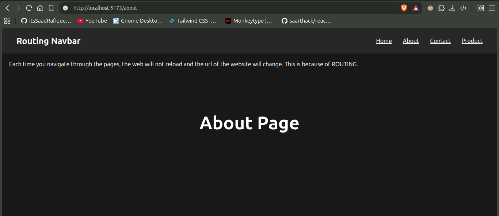

_Note: This md file contains each concepts of ReachJS following the SheriyansCodingSchool's Tutorial (11 Hours Course) from YT ._

__Before Starting ReactJS, you must know__

## 1. ReactJS Introduction
- What is reactjs ? Why facebook build it ? (Story)
- Library vs Framework
- Import/Export
- SPA and MPA

#
## 2. Create React Folder with Vite
To create a reactjs folder (with pre-build all necessary files and folders) , you need to open the terminal in the desired location you want to make a folder. 

If you already install the __NodeJS Application__ then type these commands in the teminal.

```bash 
npm create vite
```
- Name your folder 
- Select framework -> __React__
- Select Javascript  

__Now__ open the terminal in the folder you made and run these commands.

```bash 
cd folder-you-made
npm install
npm run dev
````

Your reactjs folder is created successfully have all necessary files and folders .

#
## 5. Components
Component is like a function that does specific task.

__Code__  
- App.jsx
```bash
// Component 1
export default function Hero() {
  return <div className="hero">
    <h2>Hero Section</h2>
  </div>
}

// Component 2
export function Nav() {
  return <div className="nav">
    <h2>Navbar Section</h2>
  </div>
}

// Component 3
export function Footer() {
  return <div className="footer">
    <h2>Footer</h2>
  </div>
}
```

- main.jsx
```bash
import { createRoot } from 'react-dom/client'
import './index.css'
import Hero, { Nav, Footer } from './App.jsx'

createRoot(document.getElementById('root')).render(
  <>
    <Nav />
    <Hero />
    <Footer />
  </>
)
```

_Efficient way of using components is to making a separate folder that has all the separate components/funstions_

#
## 6. Props  
Adding desired data using same function.  
Its like passing values in functions and using them.
__NOTE__ Data will always go from top to bottom .ie: Parent to child.

Let us consider a card havind username and age.  
- card.jsx
```bash
import React from 'react'

// Catching values as 'props' parameter
const Card = (props) => { 
  return (
    <div className='card'>
        {props.username} {props.age}
    </div>
  )
}

export default Card
```

- App.jsx
```bash
import Card from '../components/card.jsx'

const App = () => {
  return (
    <>
      // Here we pass desired values 
      <Card username="Bilal" age={10} />
      <Card username="Ali" age={49} />
      <Card username="Hamza" age={21} />
    </>
  )
}

export default App
```

## Project : Components and Props  
Make instagram profie like cards ( having profile pic, name , info and profile-view button) as shown in given picture.

__ScreenShot__ 


__Code__
- card.jsx
```bash
import React from 'react'

const Card = (props) => {
  return (
    <div className="card">
      
      <h2>{props.name}</h2>
      <p>Lorem ipsum dolor sit amet consectetur.</p>
      <button>View Profile</button>
    </div>
  )
}

export default Card
```

- App.jsx 
```bash
import Card from "../components/card.jsx";

const  App = () => {
  return (
    <>
      <Card name="Saad" img = "https://images.unsplash.com/photo-1529665253569-6d01c0eaf7b6?w=500&auto=format&fit=crop&q=60&ixlib=rb-4.1.0&ixid=M3wxMjA3fDB8MHxzZWFyY2h8Mnx8cHJvZmlsZXxlbnwwfHwwfHx8MA%3D%3D"/>

      <Card name="Haider" img = "https://images.unsplash.com/photo-1492562080023-ab3db95bfbce?w=500&auto=format&fit=crop&q=60&ixlib=rb-4.1.0&ixid=M3wxMjA3fDB8MHxzZWFyY2h8NTV8fHByb2ZpbGV8ZW58MHx8MHx8fDA%3D"/>

      <Card name="Waqas" img = "https://images.unsplash.com/photo-1527980965255-d3b416303d12?w=500&auto=format&fit=crop&q=60&ixlib=rb-4.1.0&ixid=M3wxMjA3fDB8MHxzZWFyY2h8NjR8fHByb2ZpbGV8ZW58MHx8MHx8fDA%3D"/>

    </>
  )
}

export default App
```
#
#
#
## __Bonus Trick__ (Passing values from Child to Parent)
There is an advance trick to pass data from child to parent. 
Consider this concept after practising useState() Hook.

- __Parent = App.jsx__
```bash 
import Navbar from './components/Navbar'
import { useState } from 'react'

const App = () => {
 
  # useState hook 
  const [theme, setTheme] = useState('light')

  return (
    <div>

      <h1>The theme is {theme}</h1>

      # here pass variable=theme and its setter fn = setTheme to child component. So the child recieves these values from props and we can change it later.
      <Navbar theme = {theme} setTheme = {setTheme} />

    </div>
  )
}

export default App

```
- __Child = Navbar.jsx__
```bash 
import React from 'react'

# here we recieved theme, and setTheme
const Navbar = (props) => {


    # on button click , the value of theme is changed
    const changeTheme = ()=>{
        props.setTheme('dark')
    }

  return (
    <div className='navbar'>
        <button
        onClick={changeTheme}
        
        >Change Theme</button>
    </div>
  )
}

export default Navbar
```

__Conclusion__:  We can pass the values from child to parent.  
1. Pass useState's ```theme```, and ```setTheme``` to child.
2. Child recieves these values and it can be changeable through ```props.setTheme```.


#
# 7. Simple CSS
We followed the method in which all of the css styles contain in only one globla style.css file .  
Which results  
- same classname elements catches the same css   
i.e __ all button having same classname (btn) catches the same styles from the global css file.

### But   
If we want all of the buttons having same name (btn) but catches the desired css styles , then we will use the concept of __MODULE CSS__ .
 
# Module CSS
In module css , we will write css in different .css files for each component.  
So this way , all of the buttons having same classname (btn) in each .css file but different styles for each button.

- example


_here button 1 and button 2 have same name (btn) in their own css file but different in styles because of their own .css files reference_

__CSS Code__
- header.module.css 
```bash
.header {
    width: 300px;
    padding: 10px;
    background-color: black;

    display: flex;
    justify-content: space-between;
    margin-bottom: 10px;
}


/* this is for button 1  */
.btn {
    background-color: rgb(239, 70, 14);
    color: white;
    padding: 5px 10px;
    border-radius: 5px;
}
```


- button.module.css
```bash
/* this if for button 2  */
.btn {
    padding: 10px 20px;
    background-color: rgb(124, 31, 206);
    border-radius: 10px;
    margin-left: 10px;
}
```

__.jsx Code__
- header.jsx
```bash
import React from 'react'
import styles from './header.module.css'


const header = () => {
  return (
    <div className={styles.header}>
      <h2>This is header</h2>
      <button className={styles.btn}>Button 1</button>

    </div>
  )
}

export default header
```
-button.jsx
```bash
import React from 'react'
import styles from './button.module.css'

const button = () => {
  return (
    <button className={styles.btn} >Button 2</button>
  )
}

export default button

``` 
in both .jsx files , the classname of button {styles.btn} = btn , which is refering to their own .css file.

__Summary__  
.css files are separated , so the styles will be different.

#

# 8.Tailwind CSS

- Install tailwind css Using Vite from official tailwind.css website.

## Project
- Making a Project of given ui .  


 
- Use component based architecture
- Use proper props drilling concept
- Use tailwind css 

## Result


#

## Functions

This folder is to understand :
- How to call a function 
- with trying different events


## Calling Function

### Without Argument
- No argument is sent and recieved  
- Simple click will print on console

```bash 
const App = () => {

  const btnClicked = ()=>{
    console.log("Button is clicked");
  }

  return (
    <div>
      <button onClick={btnClicked} className='btn'>Click Me</button>
    </div>
  )
}

export default App
```
#
### With Argument

- Now, when it is needed to send argument to function
- Use following method with a example 
- i.e. This time i am tracking the alt key via click and passing that tracked value to the function and then the fn will print it on console

```bash 
const App = () => {

  const btnClicked = (ele)=>{
    console.log('Button clicked , Alt key ',ele);
  }

  return (
    <div>
      <button onClick={function(ele){
        btnClicked(ele.altKey);
      }} className='btn'>
      
      Mouse Over

      </button>
    </div>
  )
}

export default App
```
__Result__ : This time if the user click the button while pressing alt then the printed value will be "Button clicked , Alt true"
, otherwise "Button click , Alt false".

#
# Hooks

## 1. useState
```useState``` is a React Hook that lets you add a state variable to your component

```bash
const [state, setState] = useState(initialState)
```

- Code Examples 
```bash
import { useState } from 'react';

function MyComponent() {
  const [age, setAge] = useState(28);
  const [name, setName] = useState('ACP Sahab');
  const [todos, setTodos] = useState(() => createTodos());
  // ...
  ```

  - settler Function 
  ```bash 
  const btnClicked = ()=>{
    setAge(50) // now the age is changed from 28 to 50
  }
```

# 

## Form Handling

- The default behviour of form tag ```<form>  </form>``` is to reload the page when the Submit button is presses .
- To disable this behavious explicitely , we have to call a function named ```preventDefault()``` 

```bash 
const App = () => {

  const submitAnalyzer = () => {
    console.log("Form is submitted successfully !")
  }

  return (
    <div>

      <form onSubmit={(e) => {
        e.preventDefault() 
        submitAnalyzer()
      }}>


        <div className="form">
          <input type="text" placeholder='Enter Something and Submit' />
          <button>Submit</button>
        </div>

      </form>

    </div>
  )
}

export default App
```

__Analysis__
- Before ```preventDefault()```:  The page reloads and the output is not shown permanently
- After ```preventDefault()```:  The page stops to reload . So, the output persist on console.

#


#
# Two Way Binding 
The concept of involving the REACT to deal with any situation, instead of doing it directly.  
ie: Filling the input bar with the help of react , instead of filling it directly.


- Code 
```bash 
import React, { useState } from 'react'

const App = () => {

    const [text, setText] = useState('')


    return (
        <form onSubmit={(e)=>{  
            e.preventDefault()

            console.log("Form is submitted.")
            console.log(text)
        }} >

            <div className='box'>
                <input onChange={(e)=>{
                    setText(e.target.value)

                }} className='input' type="text" placeholder='Enter here ...' value={text} />

                <button className='btn'>Submit</button>

            </div>
        </form>

    )
}

export default App
```
- Methodology
1. initialise state with empty string " "
2. tracking input values and setting it in the initialized string '' using settler function

Now , the react is involving while the user types in input bar.

### Alternate wrong method 
Wrong method : Directly interacting with input.

- Wrong method Example Code 
```bash
import React, { useState } from 'react'

const App = () => {
    return (
        <form onSubmit={(e)=>{  
            e.preventDefault()
            console.log("Form is submitted.")
        }} >

            <div className='box'>
                <input className='input' type="text" placeholder='Enter here ...'  />
                <button className='btn'>Submit</button>
            </div>
        </form>
    )
}
export default App

```
__HERE__  the user directly interacts with the input bar. React is not involves.

# 

## Note App
This project is to practise 
- form handling 
- two way binding 
- useState()
- .map()
- tailwindcss

## Feature of Note App
Note App is a basic application having 
- heading and body section
- the note is listed when the add button is clicked

## Result SS


#

# 13. API Calling
## Method 1 : Fetch

Fetch method of api calling

```bash
import { useState } from 'react'

const App = () => {

  const [data, setData] = useState([])

  const getData = async () => {
    
    # traditional fetch method
    const response = await fetch('https://picsum.photos/v2/list')

    setData(response.data)
    
  }
  return (
    <div>
      <button onClick={getData}>Get Data</button>
      <div>
        {data.map(function(elem,idx){

          return <h3>Hello, {elem.author} {idx}</h3>
        })}
      </div>
    </div>
  )
}

export default App
```

#
## Method 2 : Axios 
Calling api using axios method

- First install axios pakages. In terminal ```npm i axios```
- import ```import axios from 'axios'``` in App.jsx 

```bash
import axios from 'axios'
import { useState } from 'react'

const App = () => {

  const [data, setData] = useState([])

  const getData = async () => {
      
    # calling through axios method here 
    const response = await axios.get('https://picsum.photos/v2/list')

    setData(response.data)
    
  }
  return (
    <div>
      <button onClick={getData}>Get Data</button>
      <div>
        {data.map(function(elem,idx){

          return <h3>Hello, {elem.author} {idx}</h3>
        })}
      </div>
    </div>
  )
}

export default App
```
#
#

# Hook 2: useEffect
useEffect is a React Hook that lets you synchronize a component with an external system.
__For Example :__ Suppose there is a road and a footpath. React-Rendering-Process is like Truck which takes whole road. On the other hands , the footpaths stores some ie. functions. The functions in the footpath are waiting for the completion of React-Rendering-Process. After completion of React-Rendering-Process , the functions will execute.

```useEffect(function, dependencies?)```   
```useEffect(function)```  // This is wrong (no dependencies)

```bash
import { useEffect, useState } from "react"

const App = () => {

  const [a, setA] = useState(0)
  const [b, setB] = useState(10)


  useEffect(function(){
    console.log("useEffect is running ...")
  },[a])  // Here the depency is set for a , so when the state of 'a' change then this function will execute


  return (
    <div>
      <h1>A : {a}</h1>
      <h1>B : {b}</h1>

      <button 
      className="btn"
      onClick={()=>{
        setA(a+1)
      }}
      >Button A</button>
      
      <button 
      onClick={()=>{
        setB(b+10)
      }}
      className="btn">Button B</button>
    </div>
  )
}

export default App
```
__Analysis :__ Referring the above code, the dependency is set for 'a'. So when the state of 'a' changes then the 'useEffect' function will execute.  
```[]``` Dependency : The 'useEffect' funtion will execute for all state changing.  
```[a]``` Dependency: The 'useEffect' fn execute only when the state of 'a ' will change.  
```[b]``` Only when 'b' state changes.  
```[a,b]``` Only when the state of both 'a' and 'b' changes'


# 
# 16: Routing

Through routing, each time we navigate to different pages , the webpage will not reload . And the url of the webpage will change.

## react-router-dom

React doesn't have built-in routing methods . So , we use `react-router-dom` library.

1. In terminal : `npm i react-router-dom`
2. Wrap `<App/>` in `<BrowserRouter> <Browser/>` in main.jsx
3. ` import { Route , Routes } from 'react-router-dom'` in App.jsx and now use can use Routes container.
4. Using Routes

```bash
    <Routes>
        <Route path='/' element={ <Home/> } />
        <Route path='/about' element={ <About/> } />
        <Route path='/contact' element={ <Contact/> } />

        <Route path='/product' element={ <Product/> } />
        # nested of Product (method 1 => not good approach)
        <Route path='/product/electronics' element={ <Product/> } />
        <Route path='/product/grocery' element={ <Grocery/> } />


        # nested of Product (method 2 => good approach) -> To render , we have to add <Outlet/> on Product.jsx page
        <Route path='/product' element={ <Product/> }>
          <Route path='electronics' element={<Electronics/>} />
          <Route path='grocery' element={<Grocery/>} />
        <Route/>


        # Dynamic Routing
        Route path='/courses' element={<Courses/>} />
        # By using ':' All of the Random URLs will show RandomPage with dynamic names . In the page Courses.jsx,  we use Hook "useParams()" to catch that Random url so we can render it with the help of following name "xyz"
        <Route path="/courses/:xyz" element={<Random/>}/>


        # page not found
        <Route path='*' element={ <NotFound/> } />


    </Routes>
```

5. Creating a navbar for testing some components (home, about, contact).

```bash
import { Link } from 'react-router-dom'

const Navbar = () => {
  return (
    <div className="navbar">
      <h2>Routing Navbar</h2>

      <div>
        <Link to="/"> Home </Link>
        <Link to="/about"> About </Link>
        <Link to="/contact"> Contact </Link>
        <Link to="/product"> Product </Link>
      </div>
    </div>
  );
};

export default Navbar;
```

- **UI**



**Analysis**  
When we click on any link (home, about, contact) on navbar then the page will changed

- The URL changes
- The site not reload
- THe page changes

#

### Consclusion

**Routing :** The benefit of using routing is to stop to whole site to reload. We use `<Routes> <Routes/>` and `<Link> <Link/>`
so

- The page doesn't reloads

#

**Traditional Way :** The drawback of using anker tag `<a> <a/>` is

- The whole page reloads

#

### Dynamic Routing and Hook (useParams)

```bash
# Dynamic Routing
  Route path='/courses' element={<Courses/>} />
  # By using ':' All of the Random URLs will show RandomPage with dynamic names . In the page Courses.jsx,  we use Hook "useParams()" to catch that Random url so we can render it with the help of following name "xyz"
  <Route path="/courses/:xyz" element={<Random/>}/>
```

- Courses.jsx

```bash
import { useParams } from "react-router-dom"

const Courses = () => {
  # hook => userParams
  let params = useParams()

  return (
    <div>
        <h1>{params.id} Courses Page</h1>
    </div>
  )
}

export default Courses
```
#
## Hook: useNavigate

`useNavigate()` is majorly used to navigate

- navigate wrt page visit history ( like back button or forward button)
- single click to home

```bash

  # define hook
  const navigate = useNavigate()

  # back button
  <button
  onClick={()=>{
    useNavigate(-1)
  }}
  >← Back</button>


  # forward button
  <button
  onClick={()=>{
    useNavigate(+1)
  }}
  >Forward → </button>


  # home button (or desired page)
  <button
  onClick={()=>{
    useNavigate('/')
  }}
  > Home </button>
```
#
#